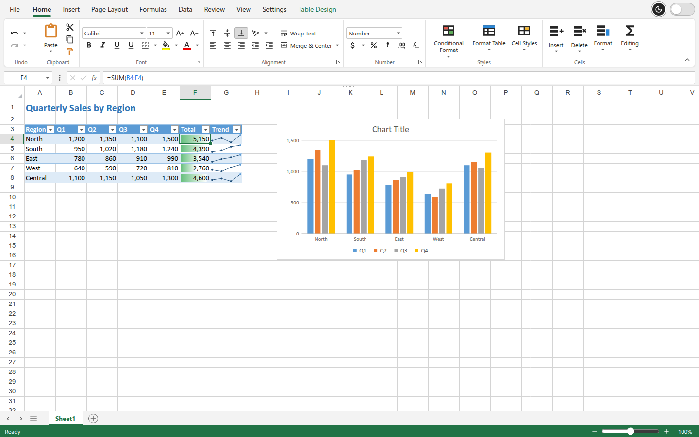
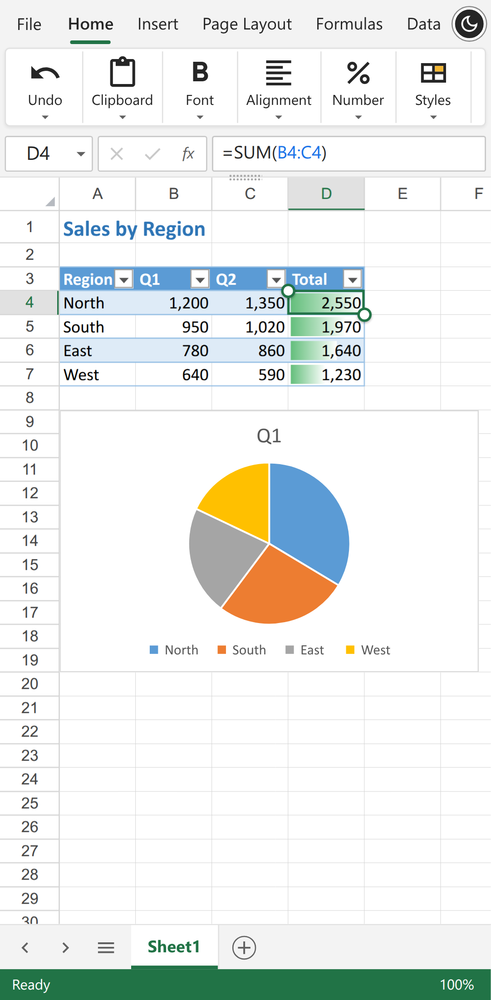
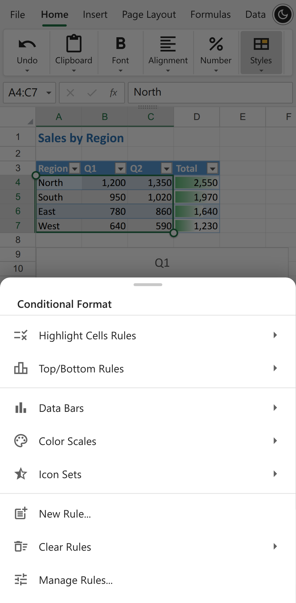

# Sheetline

Sheetline is an Excel (XLSX) editor for desktop and mobile that runs in the browser: a ribbon with
contextual tabs, a toolbar layout, light and dark themes, a File backstage, dialogs and context
menus, on its own canvas grid, formula engine and XLSX reader and writer. On phones it has a touch
layout, and it also works over a plain HTTP address on the local network.

It comes as a React component and a Vue component, each written natively for its framework on one
shared engine, in a pnpm monorepo: `@sheetline/core` (the engine, the page API and the interface
state), `@sheetline/react`, `@sheetline/vue`, and the full-page app built once with each
component.

Its features are listed area by area in [docs/feature.md](docs/feature.md).

| Desktop | Phone | Phone menu |
| --- | --- | --- |
|  |  |  |

## Run

```bash
git clone https://github.com/mas-ony/office-sheetline.git
cd office-sheetline
pnpm install
pnpm dev             # the React app: http://localhost:5176, also on the LAN address Vite prints (open it on a phone)
pnpm dev:vue         # the Vue app: http://localhost:5182
                     # open a file directly: /?src=/tests/fixtures/kitchen-sink.xlsx (skip the recovery offer: /?new=1)
pnpm build           # the packages into packages/*/dist, the apps into apps/web-react/dist and apps/web-vue/dist
                     # (installable PWAs when served over HTTPS)
pnpm build:npm       # the React app without source maps in npm/dist, for the npm package
pnpm preview         # serve the React app's build on port 4176
pnpm preview:vue     # serve the Vue app's build on port 4182
pnpm test            # unit tests (formula engine, XLSX/XLS/XLSB, data tools, charts, print, PDF)
pnpm test:e2e        # Playwright against both apps, desktop and Pixel 7 profiles (Chrome at /usr/bin/google-chrome or $CHROME_PATH)
pnpm typecheck
pnpm fixtures        # regenerate the test workbooks in tests/fixtures
```

`E2E_BASE_URL=http://<LAN address>:5176 E2E_VUE_URL=http://<LAN address>:5182 pnpm test:e2e` runs
the browser tests against plain HTTP addresses, which are insecure contexts like a phone on the
local network (no clipboard API, service workers, file pickers, share sheet or WebCrypto). The
editor feature-detects all of these.

## What works

- **Files**: opens a blank "Book1"; File backstage with New, Open, Save, Import, Export, Print
  and Info (document properties). XLSX, XLSM, XLTX and XLTM (the saved file patches the opened
  package, so everything the editor does not change is kept), XLS (Excel 97-2003) and XLSB with
  own readers, CSV and TSV; files also open by drag and drop, `?src=` and the OS "Open with"
  (installed app). Export as XLSX, XLTX, XLSM, XLTM, CSV or PDF; save back to the opened file
  where the browser allows; crash recovery from IndexedDB.
- **Ribbon**: Home, Insert, Page Layout, Formulas, Data, Review, View and
  Settings with group launchers, plus contextual Table Design, Chart Design, Shape Format,
  Picture Format and Sparkline tabs; a one-row toolbar layout; light and dark themes; a command
  palette (Alt+Q) that also finds menu items.
- **Formatting**: fonts, borders, fills, alignment and orientation, number formats, Format Cells
  (Number, Alignment, Font, Border, Fill, Protection), cell styles, Format Painter, conditional
  formatting (highlight, top/bottom, data bars, colour scales, icon sets, formula rules, Rules
  Manager), tables with styles, themes with colour and font schemes.
- **Formulas**: 499 functions with signatures and descriptions (dynamic arrays, LET, LAMBDA with
  MAP/REDUCE/SCAN/BYROW/BYCOL/MAKEARRAY, GROUPBY, PIVOTBY, odd-period bond functions, …);
  suggestions and argument tips in the cell and the formula bar; Insert Function, Name Manager,
  Create from Selection, Show Formulas, calculation options.
- **Data**: multi-level sort (values, colours, custom lists), filters, Text to Columns, Data
  Validation with Circle Invalid Data, Remove Duplicates, outlines (Group, Auto Outline,
  Subtotal, levels and detail buttons), Scenario Manager, Goal Seek, Data Table, Fill Series,
  Insert/Delete Cells with shifting.
- **Charts**: the Insert Chart dialog with 14 categories and 41 subtypes (column, line, pie and
  doughnut, bar, area, scatter and bubble, stock with volume, radar, sunburst, treemap, funnel,
  waterfall, histogram, Pareto, box and whisker, combo with secondary axis), two orientation
  previews, Chart Design (elements, quick layouts, colours, styles, select data, move chart, alt
  text) and a Format pane. Saved as Excel chart parts (chartex for the Office 2016 types).
- **Objects**: pictures, 125 shapes and text boxes, sparklines (line, column, win/loss), links,
  threaded comments with a panel, notes, symbols, Selection Pane.
- **Page layout and printing**: margins, orientation, paper size, print area, breaks, print
  titles, scaling, header and footer editor; a Print backstage with a live preview; a PDF writer
  (vector text and lines; pictures, charts, data bars, icons and sparklines embedded as images);
  printing through the browser's print dialog.
- **Review and view**: sheet and workbook protection (Excel password hashes), zoom, freeze
  panes, focus cell, show/hide headers, gridlines, tab strip, formula and status bars; Spread
  and Sheet Settings dialogs.
- **Phones**: ribbon groups, menus and context menus as bottom sheets, long press for the cell
  menu, tap to select and double tap to edit, selection handles, pinch zoom, a key bar above the
  keyboard, full-screen dialogs and backstage, charts placed under the data.

## Programming interface

### Components

`@sheetline/react` and `@sheetline/vue` each export an `SheetlineEditor` component and a
`mount()` function, with the same options. Import the package's `style.css` once (the fonts and
the editor's styles). The editor fills the height of its element, so give it (or its container) a
height.

```tsx
import { SheetlineEditor } from '@sheetline/react';
import '@sheetline/react/style.css';

<SheetlineEditor
  style={{ height: '80vh' }}
  document="/reports/budget.xlsx"
  author="Jordan Lee"
  onReady={(api) => api.on('change', () => console.log(api.getValue('B10')))}
/>
```

```vue
<script setup lang="ts">
import { SheetlineEditor, type SpreadsheetApi, type ThemeName } from '@sheetline/vue';
import '@sheetline/vue/style.css';
import { ref } from 'vue';

const theme = ref<ThemeName>('light');
const onReady = (api: SpreadsheetApi) => api.on('change', () => console.log(api.getValue('B10')));
</script>

<template>
  <SheetlineEditor v-model:theme="theme" style="height: 80vh" document="/reports/budget.xlsx"
    author="Jordan Lee" @ready="onReady" />
</template>
```

```js
// Without writing React or Vue code (either package)
import { mount } from '@sheetline/vue';
import '@sheetline/vue/style.css';

const editor = mount(document.querySelector('#editor'), { document: file, theme: 'dark' });
const api = await editor.ready;
editor.update({ readOnly: true });
editor.destroy();
```

Options, the same props in both components (`SheetlineOptions` in
`packages/core/src/ui/controller.ts`):

| Option | |
| --- | --- |
| `document` | A URL, Blob, ArrayBuffer or bytes, or `{ url or data, name }`; opened again when it changes. Without it the editor starts with a blank Book1 |
| `readOnly` | Workbooks open view-only |
| `layout` | `'ribbon'` or `'toolbar'` (the one-row toolbar, on desktop); by default the one last chosen, else the ribbon |
| `theme` | `'light'` or `'dark'` |
| `author` | The name on comments and notes, written as the author of new workbooks |
| `storageKey` | Keep the layout, theme, settings, recent colours and cell styles in localStorage under `<storageKey>-…` |
| `autosave`, `offerRecovery` | Keep unsaved changes in an IndexedDB database of this name and offer to recover them when the editor starts without a document |
| `files` | Replace some of the file actions (New, Open, Save, Export, Import, Print, Rename, Share) |
| `globalShortcuts` | Handle the editor's shortcuts (Ctrl+1, Alt+Q, F9…) anywhere on the page, not only inside the editor |

Events: `onReady(api)`, once the editor is ready and the initial workbook has opened, with the
editor's page API; `onThemeChange` with the theme in use at start and whenever the reader switches
it; `onLayoutChange` when the reader switches between the ribbon and the toolbar. In Vue they are
`@ready`, `@update:theme` and `@update:layout`, so `v-model:theme` and `v-model:layout` work.

The interface keeps its classes on its own element and on a layer it adds to the page's body for
menus, dialogs and messages (`sh-` for the interface, `xgrid-` and `xchart-` for the grid). It
changes nothing on `<html>` or `<body>`, and several editors can share a page. In a window up to
720 pixels wide it uses its phone layout.

### Page API

Each editor comes with a page API (`packages/core/src/api/api.ts`, passed to `onReady`), which
follows the workbook the editor shows. The apps put it on the page as `window.spreadsheetEditor`
(`installPageApi` from `@sheetline/core`), with methods for files, cells, sheets, the layout and
the theme:

```js
const ed = window.spreadsheetEditor;
ed.setData([['Item', 'Price'], ['Pen', 1.5]], 'A1');
ed.setValue('C2', '=B2*2');
ed.setStyle('A1:B1', 'font-weight', 'bold');
ed.setFormat('B2', '"$" #,##0.00');
ed.on('change', () => console.log(ed.getValue('C2')));
ed.setLayout('toolbar');   // or 'ribbon'
ed.setTheme('dark');       // or 'light'
ed.download('xlsx');       // also 'xltx', 'xlsm', 'xltm', 'csv'; 'pdf' opens the Print backstage
await ed.open(blob, 'Budget.xlsx');   // then window.spreadsheetEditor serves the new workbook
```

`ed.doc` gives access to the native document model (`packages/core/src/core/document.ts` and the
modules in `packages/core/src/core/doc/`) and `ed.grid` to the grid
(`packages/core/src/grid/GridView.ts`).

## Tests

- 154 unit tests (Vitest). In `@sheetline/core`: formula engine (including LAMBDA helpers and the
  newer financial, text and web functions), formula assist, XLSX import, export and round trips,
  document model, data tools (sort, Text to Columns, Remove Duplicates, insert/delete cells,
  series), outlines and subtotals, what-if analysis, sparklines, themes and templates in files,
  charts (combo, stock, sunburst, scatter styles, error bars) and shapes in XLSX files, alt text and
  hidden objects, print layout with data bars, icons and sparklines, PDF output, XLS and XLSB
  readers. In `@sheetline/react` and `@sheetline/vue`, the same scenarios for `mount()`: opening a
  workbook in the dark theme and cleaning up, the theme and layout switches reported and dialogs in
  the layer, and two editors on one page.
- 42 end-to-end tests (Playwright), the same 21 against the React app and the Vue app: 14 desktop
  (shapes and objects, opening a workbook with a chart and a picture, filters, validation, notes and
  freeze panes, sheet tabs, typing and the formula bar, the cell menu and Paste Special, ribbon tabs
  and Home formatting, a chart from Insert with Chart Design and XLSX output, the Data tab, the File
  backstage with CSV, template and PDF, the page API, conditional formatting and tables, a range
  picked on the sheet for Text to Columns and Escape in Goal Seek, dark theme, toolbar layout and
  command palette) and 7 mobile (Pixel 7: tap and double tap with the key bar, the key bar's keys
  with Functions, Done and Cancel, long press with Format Cells, opening an XLS file, ribbon groups
  as bottom sheets, a chart under the data, the backstage). The suite also passes over plain HTTP
  LAN addresses.

## Layout

| Path | Contents |
| --- | --- |
| `packages/core` | `@sheetline/core`, everything the two interfaces share |
| `packages/core/src/core` | Workbook model, formula engine (`formula/`), XLSX package reader/writer (`xlsx/`, charts and shapes in `drawingObjects.ts`, sparklines in `sparklines.ts`), XLS (`xls/`) and XLSB (`xlsb/`) readers, chart data, number formats, filters, validation, themes, undo history, the `SpreadsheetDocument` command layer (`document.ts`) and its feature modules (`doc/`: tables, conditional formats, protection, page setup, outline, data tools, what-if, sparklines, theme) |
| `packages/core/src/grid` | Canvas grid (`GridView.ts`), renderer, conditional formatting, cell decorations, outline gutter, sparklines, chart renderer (`chartRender.ts`), shape geometry (`shapes.ts`) |
| `packages/core/src/print` | Print layout (`pages.ts`), SVG pages for preview and printing, an SVG recorder for the canvas painters (`svgCanvas.ts`), PDF writer |
| `packages/core/src/ui` | The interface without a framework: its state and actions (`controller.ts`, `SheetlineUI`), ribbon tabs and commands (`ribbon/`), menus, shortcuts, the command palette, and the data and helpers of the dialogs |
| `packages/core/src/styles` | Fonts, grid styles (`grid.css`), interface styles and themes (`interface.css`) |
| `packages/core/src/api` | Page API (`SpreadsheetApi`, `installPageApi`), opening files, document sources, autosave |
| `packages/core/tests` | Vitest unit tests (with small hand-built XLS and XLSB files) |
| `packages/react` | `@sheetline/react`: `SheetlineEditor` and `mount()`; ribbon (`ribbon/`), formula bar, sheet tabs, status bar, menus, dialogs (`dialogs/`), File backstage (`backstage/`), side panels (`panels/`), mobile key bar |
| `packages/vue` | `@sheetline/vue`: the same in Vue single-file components |
| `apps/web-react` | The full-page app in React |
| `apps/web-vue` | The same app in Vue |
| `apps/web-shared` | What both apps share: `src/shell.ts` reads the address (`?src=`, `?new=1`, `?readonly=1`), turns on stored settings and autosave, sets the window title, warns before leaving with unsaved changes, opens files passed by the installed app and installs the page API; `src/app.css` has the page styles; `public/` has the icons, manifest and service worker; `vite/assetLicenses.ts` completes the builds' licence files, and `vite/testFixtures.ts` serves the test workbooks at `/tests/fixtures/` in development, for the end-to-end tests |
| `tests/e2e`, `tests/fixtures` | Playwright tests, run against both apps; test workbooks (generated by `scripts/make-fixtures.mjs`) |
| `npm` | The npm package `sheetline` (the built React app): its manifest, README and licence. Packing or publishing it there (`pnpm pack`, `npm publish`) runs `pnpm build:npm` first, and the package holds only `dist` |

## Known gaps

- The packages in `packages/` are not published to npm yet (they are marked private); another
  project can use them from this workspace or from `pnpm pack` archives.
- PivotTables, slicers, form controls, camera pictures, external data connections and sheet
  background pictures are not supported, and the ribbon has no KeyTips (Excel's keyboard
  shortcuts work instead).
- Excel 5.0/95 `.xls` files are not supported; XLS and XLSB files are saved as XLSX. Encrypted
  (password-protected) files cannot be opened or written.
- What-If Data Table writes values instead of a live `TABLE()` array.
- Cell styles created in the editor are kept in the browser, not in the file.
- Charts from files that use features the chart model does not cover (3-D charts) are drawn
  approximately; they are written back unchanged unless edited.
- Text that the standard PDF fonts cannot show (for example CJK) is embedded in the PDF as
  pictures.

## License

MIT ([LICENSE](LICENSE)). Each package in `packages/` and the npm package in `npm/` carry a copy,
with their own README for npm. The app builds write `THIRD-PARTY-LICENSES.md` next to the app,
listing the bundled packages, icons and fonts with their licences
(`apps/web-shared/vite/assetLicenses.ts` adds the fonts, which come in through CSS), and
`@sheetline/core` ships one for the icons it bundles; the fonts come from the `@fontsource`
packages under the SIL Open Font License 1.1.
